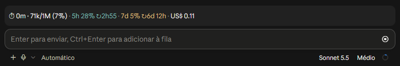

# usage-band

Mod do **Claude Code** (Desktop e terminal) que mostra uma barra acima do prompt com o uso da sessão, e um painel com barras de progresso:

<p align="center">
  
</p>

<p align="center"><em>Captura real no Claude Code Desktop: a barra fica logo acima da caixa de mensagem, com 5h em azul, 7d em amarelo e o tempo até cada limite reiniciar.</em></p>

Os números vêm **direto do Claude Code**, a cada resposta: limites, contexto e custo são os mesmos que ele usa. O mod não faz nenhuma consulta própria, não lê token e não usa a rede.

> Usa VS Code ou Antigravity? A extensão do Claude Code para o editor não desenha esta barra. Para o editor, use a extensão [claude-usage-statusbar](https://github.com/AlessandroLobo/claude-usage-statusbar).

## O que cada campo significa

| Campo | O que significa |
| --- | --- |
| `⏱ 1h36` | **Tempo da sessão**: desde o início desta conversa do Claude Code. |
| `65k/1M (7%)` | **Contexto**: tokens que o Claude está "lembrando" agora / janela do modelo. A partir de **80%** fica laranja; perto de 100%, use `/compact` ou abra uma conversa nova. |
| `5h 57% ↻3h08` | **Limite de 5 horas** da assinatura (azul): uso e tempo até a janela reiniciar. A partir de **90%** fica vermelho e aparece um aviso. |
| `7d 56% ↻1h18` | **Limite semanal** (amarelo): uso e tempo até reiniciar. A partir de **90%** fica vermelho e aparece um aviso. |
| `US$ 0.34` | **Custo** da sessão, somado pelo próprio Claude Code (quando disponível). |
| `turno 0:05` | **Duração da última resposta** do Claude, do envio até terminar. |

Todos os números chegam **a cada resposta** do Claude, direto do Claude Code — não há atraso nem consulta extra.

## Cores

As cores seguem o mesmo **degradê por uso**, o mesmo da extensão [claude-usage-statusbar](https://github.com/AlessandroLobo/claude-usage-statusbar) no VS Code/Antigravity, para a barra ficar igual nos dois lugares: a cor-base vale até 50%, vira âmbar em 75% e chega ao vermelho em 90%.

| Item | Quando | Cor |
| --- | --- | --- |
| Limites **5h** e **7d** | até **50%** | verde `#89d185` |
| Limites 5h e 7d | de **50%** a **90%** | verde → âmbar `#e5a50a` (75%) → vermelho |
| Limite 5h ou 7d | a partir de **90%** | vermelho `#f14c4c`, e um aviso (toast) aparece |
| Contexto (texto) | a partir de **75%** | âmbar → vermelho |
| Barra de contexto no painel | até **50%** | verde `#89d185`, com o mesmo degradê |
| Separadores `·` | sempre | esmaecidos |

São tons pensados para fundo escuro; num tema claro do Claude Code ficam mais suaves.

## Painel

Em cada limite o painel mostra o tempo restante e o horário do reinício, por exemplo `Reseta em 2h18 (às 19:08)` e, no semanal, `Reseta em 4d 4h (ter. às 21:00)`.

`/uso painel` abre o painel **Uso do Claude**, com barras de progresso nas mesmas cores:

```
USO DA ASSINATURA
Sessão (5h)                          35%
█████████████░░░░░░░░░░░░░░░░░░░░░░░░░
Reseta em 3h22

Semanal (7 dias)                     19%
███████░░░░░░░░░░░░░░░░░░░░░░░░░░░░░░░
Reseta em 2d 4h

SESSÃO ATUAL
Contexto                             12%
████░░░░░░░░░░░░░░░░░░░░░░░░░░░░░░░░░░
120k/1M (12%)
Tempo                                60m
Custo                            US$ 0.82
Último turno                        0:58
```

O painel aparece onde a tela comporta um (no terminal, ao lado da conversa em tela cheia a partir de 110 colunas; nos demais casos, acima do prompt). Se a tela não puder exibi-lo, `/uso painel` avisa e a barra continua funcionando.

## Onde mostrar

Você escolhe onde ver o uso. Cada lugar tem o seu interruptor:

| Quero ver | Acima do chat (este plugin) | Barra de status (extensão [claude-usage-statusbar](https://github.com/AlessandroLobo/claude-usage-statusbar)) |
| --- | --- | --- |
| **Só acima do chat** | ligado | desligada |
| **Só na barra de baixo** | desligado | ligada |
| **Nos dois** (padrão) | ligado | ligada |

**Acima do chat (este plugin):** no Claude Code, `/plugin` → **usage-band** → **Configure** → desligue **Mostrar a barra acima do prompt**. Pelo terminal: `claude plugin configure usage-band`. A mudança recarrega o plugin; o painel (`/uso painel`) continua disponível. Para esconder só na sessão atual, use `/uso`. Exige a versão 0.3.0 ou mais nova.

**Barra de status (extensão do VS Code/Antigravity):** `Ctrl+,` → busque **Claude Usage** → desmarque **Show Status Bar**. Detalhes no README da extensão.

## Comandos

| Comando | Ação |
| --- | --- |
| `/uso` | Mostra/oculta a barra acima do prompt |
| `/uso painel` | Abre o painel com barras |

## Instalação

No Claude Code (Desktop ou terminal):

```
/plugin install usage-band --marketplace AlessandroLobo/alessandrolobo-usage-band
```

Responda `y` para adicionar o marketplace e escolha o escopo **user**, para carregar em todas as sessões.

Ou com **um comando** no PowerShell (ou em qualquer terminal) — adiciona o marketplace e instala no escopo **user**:

```powershell
claude plugin install usage-band --marketplace AlessandroLobo/alessandrolobo-usage-band
```

Depois, reinicie o Claude Code (ou abra uma sessão nova).

## Atualização

O Claude Code não atualiza o mod sozinho. Para receber uma versão nova, um comando no PowerShell:

```powershell
claude plugin marketplace update eficaz-mods; claude plugin update usage-band@eficaz-mods
```

Depois, **reinicie o Claude Code** (ou abra uma sessão nova). Quem não atualizar continua com a versão que tem, funcionando normalmente.

## Desinstalação

Para **desligar sem remover** (dá para religar depois):

```powershell
claude plugin disable usage-band@eficaz-mods
```

Para **remover** o plugin:

```powershell
claude plugin uninstall usage-band@eficaz-mods
```

Para remover também o marketplace (opcional, só se não for usar outros mods dele):

```powershell
claude plugin marketplace remove eficaz-mods
```

Depois, **reinicie o Claude Code** (ou abra uma sessão nova). Pelo Claude Code, o equivalente é abrir `/plugin`, escolher **usage-band** e desativar ou desinstalar.

Para só **ocultar a barra** sem mexer no plugin, use `/uso` (de novo para mostrar).

## Desenvolvimento

```
claude plugin validate .
claude plugin test .
```

`hooks/register.tsx` é o módulo do mod (barra, painel e comando), `types/index.d.ts` declara o estado que ele guarda e `tests/band.test.tsx` cobre a barra e o painel no terminal e no Desktop.

Para publicar uma versão: aumente `version` em `.claude-plugin/plugin.json`, faça commit e push. Quem já instalou recebe com os comandos de [Atualização](#atualização).

## Privacidade

O mod só lê o que o próprio Claude Code entrega a ele (uso da sessão, limites e custo) e guarda esses valores no estado da sessão. Não faz requisições de rede, não lê credenciais e não grava arquivos. Projeto não oficial, sem vínculo com a Anthropic.
